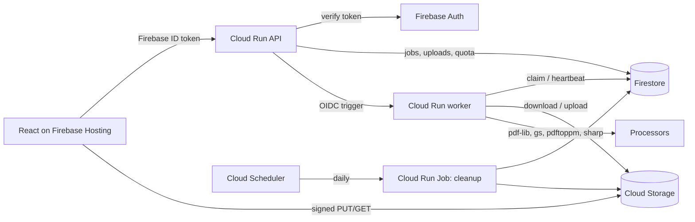

# UtilityHub

Cloud-native document and data utilities. The browser uploads directly to
Google Cloud Storage with signed URLs; a Cloud Run worker performs real
processing; Firestore tracks job state; results expire automatically.


> **Deployment status:** the application is fully refactored and locally
> verified, but **not deployed**. No GCP project or credentials were available
> in this workspace. See [`docs/TEST_REPORT.md`](docs/TEST_REPORT.md) for exactly
> what was and was not tested.

## What it does

| Category | Tools |
| --- | --- |
| PDF | Merge, split, compress, rotate, PDF → images, images → PDF |
| Photo | Image converter, compressor, color picker |
| Data | CSV → JSON, JSON → CSV, JSON formatter, table preview |
| Text | Case changer, counter, line/whitespace cleaner |
| Office (local) | DOCX → TXT, TXT → DOCX, PPTX → TXT, TXT → PPTX |
| Utilities | Unit converter, percentage calculator (instant, client-side) |

Cloud tools use real engines: `pdf-lib`, Ghostscript, Poppler, Sharp, and
PapaParse. There is no fake progress and no simulated result. Unit and
percentage utilities run in the browser and are labeled `INSTANT`. Office tools
run in the browser with `mammoth`, `docx`, `JSZip`, and `PptxGenJS`; they are
labeled `● LOCAL` and their bytes never reach the API, GCS, or a worker.

## Architecture



Key properties:

- The browser never sends file bytes through the API.
- DOCX and PPTX files are intercepted by `FileServiceRouter` and processed by
  `LocalFileAdapter`; they are never uploaded to GCS or sent to a worker.
- Production refuses local storage, in-memory data, or dev auth at startup.
- Jobs are user-scoped and use 90-second leases with heartbeat and retry.
- Results expire after 24 hours; GCS lifecycle is a one-day safety net.
- Firestore rules deny all client access; only the Admin SDK writes.

## Stack

- **Frontend:** React 19, Vite 8, Firebase Auth 11, custom Neo-Brutalist CSS.
  Local Office tools use `mammoth`, `docx`, `jszip`, `pptxgenjs`, and
  `fast-xml-parser`.
- **Backend:** Node 22, Express 5, Zod, Pino, `pdf-lib`, Sharp, Ghostscript,
  Poppler, `archiver`.
- **Cloud:** Cloud Run, Firestore Native, Cloud Storage, Firebase Auth,
  Firebase Hosting, Secret Manager, Cloud Scheduler, Cloud Build, Artifact
  Registry, Cloud Logging.

## Local development

No cloud account is needed.

```bash
cd backend
cp .env.example .env
npm ci
npm start
```

```bash
cd frontend
cp .env.example .env.local
npm ci
npm run dev
```

Open <http://localhost:5173> and choose **Dev sign in**. The frontend sends
`X-Dev-User`; the backend accepts it only in `AUTH_MODE=dev`. Local jobs run in
an in-process runner because the memory store is process-local.

The whole stack can also run with Docker:

```bash
docker compose up --build
```

Set `VITE_AUTH_MODE=dev` (the default in development) or configure a real
Firebase web app with the `VITE_FIREBASE_*` values in `frontend/.env.example`.

## Testing

```bash
cd backend && npm test     # 42 tests
cd frontend && npm run build
cd frontend && npm run verify:local-office
```

The backend suite covers the API surface, all 16 processors, signed flows,
ownership, quotas, lease recovery, cleanup, worker auth, and production config
guardrails. The local Office verifier builds 5 MB DOCX/PPTX inputs, runs every
browser conversion, reopens the generated artifacts, blocks Office → PDF, and
asserts that `fetch` is never called. A full browser run (sign in → upload →
process → download) was verified with headless Chrome; details are in the test
report.

## API

Base path: `/api/v1`

| Method | Path | Purpose |
| --- | --- | --- |
| `GET` | `/health/live`, `/health/ready` | Liveness / dependency readiness |
| `GET` | `/operations` | Catalog of cloud and client tools |
| `POST` | `/auth/session` | Upsert the signed-in user |
| `GET` | `/me` | Current profile |
| `POST` | `/uploads/init` | Create upload records and signed PUT URLs |
| `DELETE` | `/uploads/:id` | Discard an unused upload |
| `POST` | `/jobs` | Create a job from uploaded files |
| `GET` | `/jobs/:id` | Poll status and result metadata |
| `GET` | `/jobs/:id/download` | Signed result download URL |
| `DELETE` | `/jobs/:id` | Delete a result or cancel a queued job |
| `GET` | `/me/jobs` | Job history |
| `DELETE` | `/me/jobs` | Clear finished history |

Full request/response shapes and error codes:
[`docs/API_CONTRACT.md`](docs/API_CONTRACT.md).

## Deployment

Infrastructure and release steps are documented, not executed:

```bash
PROJECT_ID=your-project ./infra/setup-gcp.sh
gcloud builds submit --config cloudbuild.yaml \
  --service-account=utilityhub-build@your-project.iam.gserviceaccount.com \
  --substitutions=...
```

See [`docs/GCP_DEPLOYMENT.md`](docs/GCP_DEPLOYMENT.md) for provisioning,
Firebase Auth setup, Cloud Build substitutions, and troubleshooting, and
[`docs/DEPLOYMENT_RUNBOOK.md`](docs/DEPLOYMENT_RUNBOOK.md) for rollback and
incident procedures.

## Repository layout

```text
backend/
  src/
    config/        environment schema and production guardrails
    lib/           auth, storage, stores, processors, runner, services
    middleware/    request id, auth, rate limit, errors
    routes/        health, operations, auth, uploads, jobs, me, dev-storage
  tests/           API, processors, lifecycle, config, worker auth
frontend/
  src/
    components/    header, auth modal, dropzone, job panel, badges
    context/       Firebase/dev auth
    pages/         home, browse, recent, settings, tool pages
    services/      FileServiceRouter and LocalFileAdapter (Office stays local)
    api.js         signed-upload and job client
    styles.css     Neo-Brutalist design system
infra/             GCP provisioning, Firestore rules/indexes, GCS lifecycle
docs/              current architecture, contract, deployment, and test reports
cloudbuild.yaml    build/push/deploy pipeline
firebase.json      Hosting rewrites, headers, Firestore paths
```

## Design

Dark `#0F0F0F` / light `#FAFAFA`, mustard `#FFD54F`, mint `#69F0AE`.
Headings use Anton, Oswald, and Archivo Black; body copy uses Inter; metadata
uses JetBrains Mono. Borders are 1–2 px, shadows are offset blocks, and there
are no gradients, glass effects, or excessive rounding.

## Documentation

Start at [`docs/README.md`](docs/README.md). Pre-refactor documents are marked
superseded and retained only for traceability.
