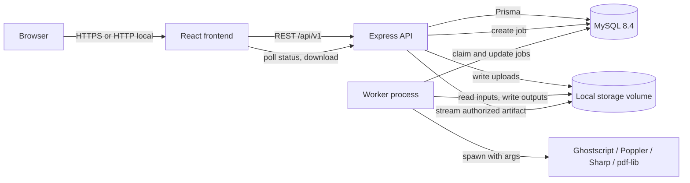
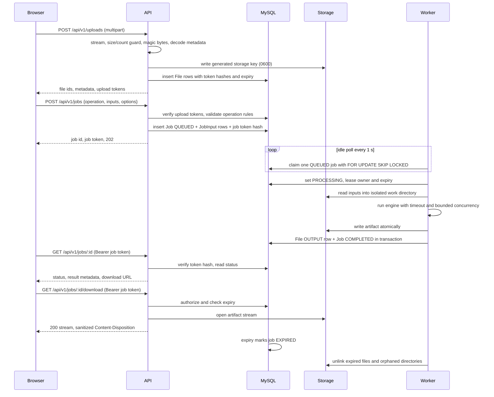
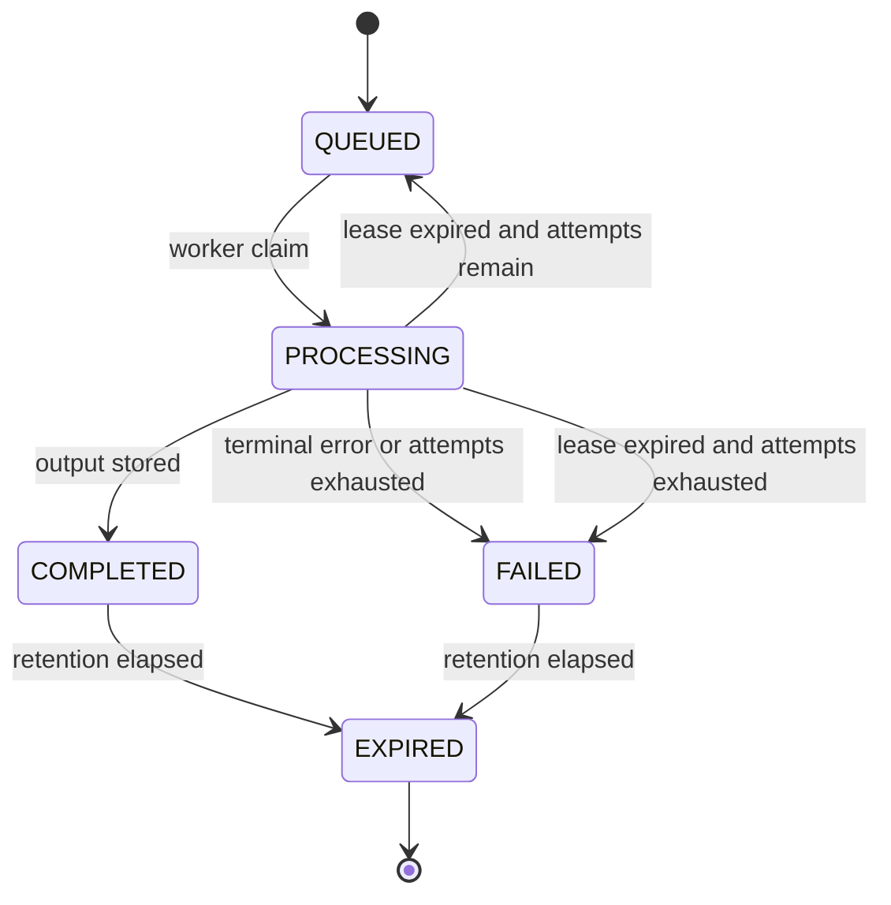
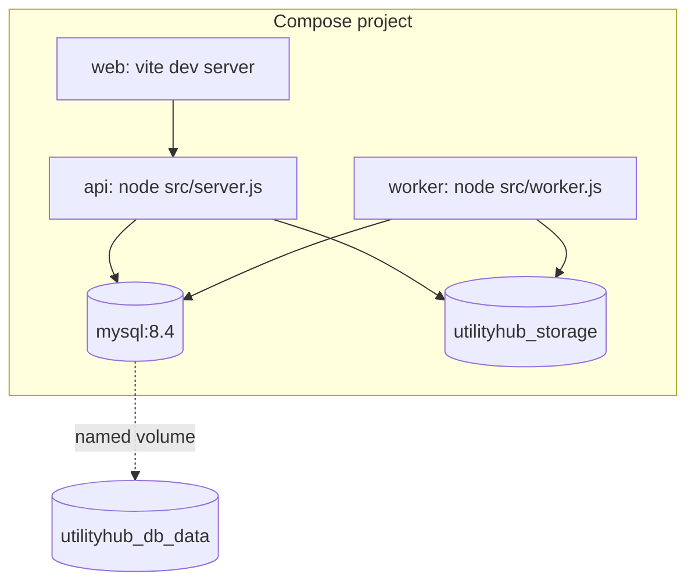

> **Superseded (2026-11-18).** This document describes the pre-GCP
> architecture (MySQL, Prisma, local disk, and/or WordPress identity). It is kept
> for traceability. See [docs/README.md](./README.md) for the current set.

# UtilityHub — System Architecture

Version: 1.0
Date: 2026-11-17
Related: `docs/PRD.md`, `docs/DATABASE_DESIGN.md`, `docs/API_SPECIFICATION.md`, `docs/PROCESSING_PIPELINE.md`, `docs/SECURITY_DESIGN.md`, `docs/TECHNOLOGY_DECISIONS.md`

## 1. Architectural style

UtilityHub is a modular monolith with two runtime entrypoints built from one Node.js codebase:

- an Express HTTP API process;
- a background worker process.

Both share the same modules, Prisma schema, MySQL database, and local storage volume. There is no message broker, cache, or service mesh. The database is the job queue and the source of truth.



Runtime responsibilities:

| Component | Owns | Never does |
| --- | --- | --- |
| Frontend | File selection, ordering, option forms, upload progress, polling, download UX | Trusted validation, direct filesystem access, storing secrets beyond the current tab |
| API | HTTP contracts, authentication of capabilities, upload streaming, validation, job creation, status, authorized download, deletion requests | Heavy document processing, filesystem cleanup, direct exposure of storage paths |
| Worker | Job claiming, processing, output storage, lease renewal, expiration, cleanup, reconciliation | Serving HTTP, accepting uploads, trusting user input |
| MySQL | Job state, file metadata, ownership references, leases, sanitized errors, timestamps | Storing document binaries |
| Local storage | Inputs, outputs, temporary work directories | Public serving or path discovery |

## 2. Why this shape

### Why a modular monolith

The MVP has one bounded product domain, one database, and one deployment owner. A monolith keeps transactions simple, avoids network failure modes, and is easier to run on the audited 15 GiB host. Module boundaries are enforced by directory structure and import discipline rather than network calls. Extracting a service later is possible if a real scaling constraint appears.

### Why a separate worker process

Document rendering and compression are CPU- and memory-heavy. Running them in the API process would starve status and upload requests, and a renderer crash would take down the API. A separate process isolates failures, allows independent restart, enables bounded concurrency, and permits the worker container to carry native engines without inflating the API image. The worker is not a microservice: it imports the same code and uses the same database.

### Why MySQL is the queue

At MVP scale, a durable table with row locking is sufficient and avoids Redis, RabbitMQ, and their operational overhead. MySQL 8.4 provides InnoDB transactions and `SELECT ... FOR UPDATE SKIP LOCKED`, which supports safe concurrent claiming and crash recovery without an external broker. The tradeoff is polling latency, controlled by a 1-second idle poll and immediate wake-up after a claimable job is seen. If throughput later exceeds a single worker pool, the same interface can be backed by a broker without changing API contracts.

### Why files live outside MySQL

MySQL row size, backup size, replication cost, and memory pressure make binary storage inappropriate. Filesystem storage keeps database queries small and lets the API stream downloads without materializing documents in memory. A storage abstraction isolates local-disk details so an object store can replace it later.

### Why Prisma 6.19.3

Prisma provides typed schema, migrations, and MySQL access with one toolchain. Version 6.19.3 keeps the classic `mysql` provider and plain-JavaScript workflow. Prisma 7/8 introduce driver adapters, generated-client output changes, and a new config surface that add risk without product value for this MVP. The decision is recorded in `docs/TECHNOLOGY_DECISIONS.md` and can be revisited after the MVP.

## 3. Repository layout

```text
utilityhub/
  backend/
    prisma/
      schema.prisma
      migrations/
    src/
      config/            environment parsing and constants
      database/          Prisma client lifecycle
      middleware/        request id, errors, rate limits, job auth
      modules/
        health/          liveness and readiness
        operations/      supported-operation catalog
        uploads/         multipart intake and validation
        files/           metadata, storage abstraction, sanitization
        jobs/            creation, status, ownership, claiming primitives
        downloads/       authorized artifact streaming
        processing/      registry, runner, engines, operation implementations
      workers/           worker loop, lease renewal, cleanup, reconciliation
      utils/             tokens, errors, logger, page ranges, process spawn
      app.js             Express app assembly
      server.js          API entrypoint
      worker.js          worker entrypoint
    test/
    Dockerfile
  frontend/
    src/
      api/               typed REST client
      components/        shared UI
      pages/             home and tool pages
      state/             per-tool workflow state
    index.html
    vite.config.js
    Dockerfile
  compose.yaml
  .env.example
  docs/
```

Rules:

- Modules expose an explicit service API; route files do not import Prisma directly.
- `processing` imports storage and engine adapters, not Express.
- `workers` imports job services and processing, never HTTP middleware.
- API and worker entrypoints instantiate shared infrastructure and start different loops.
- Future tools are added under `processing/operations` and the registry, not by branching inside existing processors.

## 4. End-to-end flow



## 5. Module boundaries

| Module | Public responsibilities | Internal detail |
| --- | --- | --- |
| `config` | Parse and validate environment once; expose typed config object | No defaults hidden in feature code |
| `database` | Single Prisma client; connect/disconnect; health query | Connection pool configuration |
| `health` | Liveness, readiness, storage check | No document access |
| `operations` | Static catalog descriptors: ids, input rules, option schema, limits | Shared by API and worker validation |
| `uploads` | Multipart handling, streaming to storage, per-request limits | Calls file validation and metadata persistence |
| `files` | Signature detection, PDF/image metadata, generated names, storage adapters, deletion | Never returns storage keys to clients |
| `jobs` | Create, authorize, read, mark deleted, claim, complete, fail, expire | Token hashing, lease guard, transactional transitions |
| `downloads` | Authorize, resolve artifact, stream, set headers | No path exposure |
| `processing` | Registry dispatch, temp workspaces, timeouts, engine adapters, six processors | Engine binaries invoked with argument arrays |
| `workers` | Claim loop, heartbeat, cleanup, reconciliation, graceful shutdown | Bounded concurrency, no HTTP |
| `middleware` | Request ID, error normalization, rate limiting, security headers, CORS | Uniform error envelope |
| `utils` | Token generation and hashing, page range parser, spawn wrapper, logger, errors | Pure or near-pure functions |

## 6. Upload and validation pipeline

1. Express receives `multipart/form-data` on `POST /api/v1/uploads`.
2. Multer streams each part to a temporary file under the storage root with a generated name; nothing is buffered in memory beyond stream chunks.
3. Per-file size, per-request file count, and cumulative request size are enforced during streaming. Exceeding a limit aborts the request and removes all temporary files.
4. The first 4,100 bytes are inspected for a signature. PDF requires `%PDF-` within the first 1,024 bytes. Images require JPEG, PNG, WebP, or TIFF signatures.
5. PDFs are inspected with `pdfinfo` under a timeout: page count, encryption status, and parseability. Images are decoded with Sharp for dimensions and format confirmation.
6. Metadata is persisted; the file is atomically renamed into its final upload path; an upload token is generated and only its SHA-256 hash is stored.
7. A partial failure removes every temporary and finalized file from the same request. Database rows are created only after all files in the request validate.
8. The response contains file ids, sanitized display names, detected MIME type, sizes, page counts, and upload tokens. Storage keys never appear.

Rejected inputs: empty files, extensions that disagree with detected type, client MIME types that disagree with detected type, encrypted PDFs, PDFs above the page limit, images above the pixel limit, and any unsupported signature.

## 7. Job lifecycle and state machine



Guarantees:

- Every transition is a conditional database update guarded by the expected prior status and, for processing, the lease owner.
- `PROCESSING` is set in the same transaction that selects and locks a queued row.
- A job is never processed by two workers because the claim holds a row lock and updates status atomically.
- The output file row and `COMPLETED` status are committed together. A crash between filesystem write and commit leaves an orphan that reconciliation removes.
- Attempts are incremented on claim. Lease-expiry recovery may requeue until `maxAttempts` (default 2 total attempts). Validation and deterministic engine failures are terminal immediately.
- A worker that loses its lease stops and must not update job state.
- Inputs referenced by a non-terminal job are never deleted, even if their nominal expiry passes.

Detailed SQL and indexes are in `docs/DATABASE_DESIGN.md`; recovery and cleanup behavior is in `docs/PROCESSING_PIPELINE.md`.

## 8. Processing engine selection

| Operation | Primary engine | Supporting code | Reason |
| --- | --- | --- | --- |
| Merge PDF | pdf-lib | Signature and page validation | Pure JS, deterministic page copying, no native install |
| Split PDF | pdf-lib | Range parser, `archiver` for multi-part ZIP | Copy pages without re-rendering; preserves quality |
| Compress PDF | Ghostscript 10.05 `pdfwrite` | Size comparison, original fallback | Mature compression presets; pdf-lib cannot rewrite streams efficiently |
| Rotate PDF | pdf-lib | Page selector | Rotation is a page attribute; no rasterization needed |
| Images to PDF | Sharp + pdf-lib | EXIF handling, JPEG normalization | Sharp handles multiple formats safely; pdf-lib embeds images |
| PDF to Images | Poppler `pdftoppm` | Range parser, `archiver` | Reliable rasterization at controlled DPI with page limits |

Engine adapters live under `modules/processing/engines`. Processors never construct commands as strings. The launcher passes an argument array with `shell: false`, a restricted environment, a per-job working directory, a hard timeout, and bounded output capture. Ghostscript runs with `-dSAFER`. This design permits swapping or adding engines, such as LibreOffice for future Office conversion, without changing job orchestration.

## 9. Storage design

The storage abstraction exposes:

| Operation | Contract |
| --- | --- |
| `createWorkDir(jobId)` | Creates a `0700` directory under `tmp/` and returns an opaque handle |
| `putFromStream(stream, area, extension)` | Writes a new file under a generated key, returns key, size, SHA-256 |
| `putFromFile(path, area, extension)` | Atomically moves a completed temp file into final storage |
| `openRead(key)` | Returns a readable stream after key validation |
| `stat(key)` | Returns size and existence |
| `remove(key)` | Deletes a file idempotently |
| `removeWorkDir(handle)` | Recursively deletes only the job's work directory |

Layout under a root configured by `STORAGE_ROOT`:

```text
storage/
  uploads/<yyyy>/<mm>/<uuid>.<ext>
  outputs/<jobId>/<uuid>.<ext>
  tmp/<jobId>/<random>/
```

Rules:

- Keys are generated, never derived from user names.
- Root resolution is canonicalized; every final path must remain inside the root.
- Files are `0600`, directories `0700`, process `umask` is `0077`.
- The root is outside the frontend build and never served statically.
- Uploads use the storage extension derived from detected type, not the original extension.
- Worker reads inputs through storage keys from the database; clients never see them.
- Local filesystem is the only MVP backend. The interface supports an object-store implementation later.

## 10. Download authorization

- Job creation returns a 256-bit job token. Only its SHA-256 hash is stored.
- Status, download, and delete requests send `Authorization: Bearer <jobToken>`.
- The API hashes the presented token, looks up the job, and authorizes only on an exact hash match.
- Unknown job id and wrong token return `404` with the same error shape to prevent enumeration. A valid token for an expired or deleted job returns `410`.
- Completed but expired jobs return `410`. A non-terminal job returns `409` on download.
- Downloads stream from storage; the API does not buffer the artifact.
- `Content-Disposition` uses a sanitized server-generated filename. No storage key or filesystem path is returned.
- Cache headers are `private, no-store`; `X-Content-Type-Options: nosniff` is set.
- A job token grants access until expiry or deletion; no account is required. Authenticated ownership, when added, will additionally constrain access to the external identity.

## 11. Queue, leases, and recovery

Claim query, executed in an interactive transaction with `READ COMMITTED`:

```sql
SELECT `id`
FROM `Job`
WHERE `status` = 'QUEUED'
ORDER BY `queuedAt` ASC
LIMIT 1
FOR UPDATE SKIP LOCKED
```

The same transaction updates the row to `PROCESSING`, sets `leaseOwner` to the worker identity, sets `leaseExpiresAt` to now plus 60 seconds, increments `attempts`, and stamps `startedAt` and `heartbeatAt`. Committing releases the row lock.

- Heartbeat renews the lease every 15 seconds while processing.
- Operation timeouts are below the maximum tolerated stall and bounded by configuration.
- Lease expiry recovery runs every 60 seconds and at startup: `PROCESSING` jobs with an expired lease are reset to `QUEUED` when attempts remain, otherwise `FAILED` with `WORKER_LOST`.
- Completion and failure updates require `status = PROCESSING` and the same `leaseOwner`; a stale worker cannot overwrite a recovered job.
- Idle workers poll every 1 second. Concurrency is capped by `WORKER_CONCURRENCY` (default 2).
- Graceful shutdown stops claiming, waits for active jobs up to a grace period, then exits; unfinished leases are recovered by another worker or on restart.

## 12. Cleanup and retention

The worker owns all destructive cleanup to avoid API/worker races.

| Sweep | Frequency | Behavior |
| --- | --- | --- |
| Expire jobs | 60 seconds | Terminal jobs past `expiresAt` become `EXPIRED`; output files are queued for deletion |
| Delete expired files | 5 minutes | Unreferenced inputs and expired outputs are unlinked, then marked `DELETED`, in batches of 100 |
| Purge expired metadata | 5 minutes | Jobs `EXPIRED` for 24 hours are deleted with their join rows |
| Orphan reconciliation | 60 minutes and startup | Files older than 24 hours with no database reference and stale work directories are removed |
| Storage guard | Before each job | Refuse processing when free space is below 2 GB |

Cleanup is idempotent, logs counts rather than filenames, and never deletes files referenced by `QUEUED`, `PROCESSING`, or non-expired `COMPLETED` jobs.

## 13. API surface summary

Full contracts are in `docs/API_SPECIFICATION.md`.

| Method | Path | Purpose |
| --- | --- | --- |
| GET | `/api/v1/health/live` | Process liveness |
| GET | `/api/v1/health/ready` | Database and storage readiness |
| GET | `/api/v1/operations` | Supported operations and option schemas |
| POST | `/api/v1/uploads` | Stream and validate files |
| DELETE | `/api/v1/uploads/:fileId` | Discard an unused upload |
| POST | `/api/v1/jobs` | Create a queued job |
| GET | `/api/v1/jobs/:jobId` | Status and result metadata |
| GET | `/api/v1/jobs/:jobId/download` | Authorized artifact stream |
| DELETE | `/api/v1/jobs/:jobId` | Delete a terminal job and schedule file removal |

All responses use one success and one error envelope, include a request id, and avoid storage internals.

## 14. Docker Compose topology



| Service | Image/build | Ports | Depends on | Notes |
| --- | --- | --- | --- | --- |
| `db` | `mysql:8.4` | `3307:3306` | — | UTC, utf8mb4, healthcheck via `mysqladmin ping` |
| `api` | backend Dockerfile | `4000:4000` | `db` healthy | Mounts storage volume; non-root user |
| `worker` | backend Dockerfile | none | `db` healthy | Same image, `node src/worker.js`; native engines installed; 2 CPU / 2 GiB limit |
| `web` | frontend Dockerfile | `5173:5173` | `api` | Vite dev server with `/api` proxy; production build served by preview for local verification |

Both API and worker mount the same named storage volume because they must share the filesystem. MySQL stores only metadata. The API and worker images run as a non-root user. No service is exposed beyond localhost by default.

For faster iteration, the documented workflow is `docker compose up -d db`, then API, worker, and frontend on the host. Native Ghostscript and Poppler are already available on the host, matching the container packages.

## 15. Logging and error handling

- Pino writes JSON to stdout. `pino-http` attaches a request id and response duration.
- Every log line may include request id, job id, operation, status, attempts, duration, byte counts, and an internal error code.
- Tokens, authorization headers, storage keys, filesystem paths, original file content, and document text are never logged. Upload names are replaced by file ids in logs.
- Errors have a stable public code and message plus an internal detail reserved for logs.
- The API maps known errors to 4xx/5xx and unknown errors to `500 INTERNAL_ERROR` with a request id.
- The worker stores `errorCode` and a 500-character sanitized message on the job; stack traces stay in logs.
- Engine stderr is captured with a size cap and sanitized before logging; it is never returned to the client.
- Unhandled rejections and uncaught exceptions are logged, then the process exits non-zero so Docker restarts it.

## 16. Security boundaries

| Boundary | Trust level | Controls |
| --- | --- | --- |
| Browser to API | Untrusted | Validate every field, stream with limits, capability tokens, rate limits, CORS allowlist |
| API to storage | Trusted process, untrusted input | Generated keys, canonical containment, `0600`/`0700`, no static serving |
| API to database | Trusted with least privilege | Parameterized Prisma and raw queries, UtilityHub database only |
| Worker to engine binaries | Untrusted file input | Argument arrays, `shell: false`, restricted env, temp cwd, timeout, output caps, `-dSAFER` |
| Worker to database | Trusted | Lease-guarded transitions, transactions |
| Future WordPress to API | External identity | Signed short-lived token, verified signature and audience, no database coupling |

Details, threat model, and verification checklist are in `docs/SECURITY_DESIGN.md`.

## 17. Failure scenarios

| Failure | Detection | Behavior |
| --- | --- | --- |
| MySQL unavailable | Readiness probe, Prisma error | API returns `503`; worker retries with backoff; no job state corruption |
| Storage full or unavailable | Preflight free-space check, write error | Job fails with `STORAGE_UNAVAILABLE`; existing data untouched |
| Worker crash mid-job | Lease expiry | Job requeued or failed after attempts exhausted |
| Duplicate workers | Row lock and conditional update | Only one claim succeeds |
| Engine missing | Spawn error | Job fails with sanitized `ENGINE_UNAVAILABLE`; readiness unaffected |
| Engine hangs | Timeout | Child killed; job fails with `PROCESSING_TIMEOUT` |
| Corrupt or encrypted input | Upload validation or processor load error | Rejected at upload or failed job with actionable message |
| Output missing after crash | Download stat and reconciliation | Job marked failed/expired; orphan cleaned |
| Token theft via URL | Tokens never placed in URLs | Header-only transmission |
| Client disconnect during upload | Multer abort and cleanup | Partial files removed |
| Frontend poll after expiry | `410` response | UI shows expiry and offers re-upload |

## 18. Adding future tools

To add a tool without redesign:

1. Add a processor module implementing a shared contract: `validateOptions`, `validateInputs`, `run(context)`, `timeoutMs`, `resultSummary`.
2. Add an operation descriptor to the catalog with input kinds, counts, and an option schema.
3. Add engine adapters if a new binary is needed; register installation in the worker image.
4. Add UI pages driven by the catalog and shared upload/status components.
5. Add tests with real fixtures.

No database migration is needed for a new operation because the operation is stored as a validated string. New output MIME types reuse the file table. New engines do not change job claiming or downloads. Word/Excel/PowerPoint conversion would add a LibreOffice adapter and converters; OCR would add a Tesseract adapter. Both stay inside the worker.

## 19. Architecture consistency checks

- Every PRD tool has exactly one processor and one engine decision.
- The database schema supports all job states, leases, ownership, file expiry, and retries.
- Retention, download authorization, and cleanup are defined and assigned to the worker.
- The API never performs heavy processing and never exposes storage keys.
- No Redis, broker, microservice, or cloud dependency exists.
- Compose covers database, API, worker, frontend, and shared storage.
- Guest processing has no dependency on WordPress.
