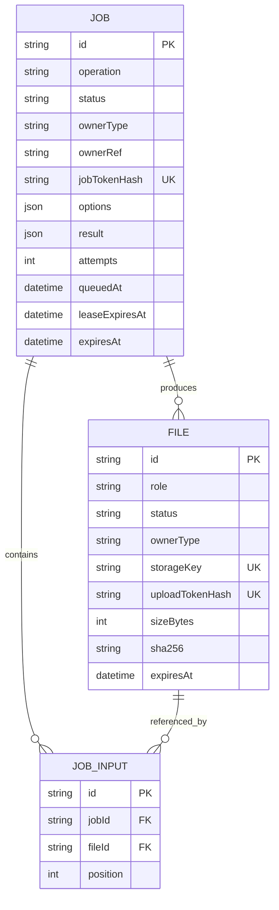

> **Superseded (2026-11-18).** This document describes the pre-GCP
> architecture (MySQL, Prisma, local disk, and/or WordPress identity). It is kept
> for traceability. See [docs/README.md](./README.md) for the current set.

# UtilityHub — Database Design

Version: 1.0
Date: 2026-11-17
Engine: MySQL 8.4 (InnoDB, utf8mb4, UTC)
Access layer: Prisma ORM 6.19.3 and parameterized raw SQL for queue operations
Database name: `utilityhub`

## 1. Design goals

- Persist every job and its lifecycle timestamps durably.
- Support safe concurrent claiming with row-level locking, without an external queue.
- Store file metadata and ownership references, never file binaries.
- Allow lease-based crash recovery and bounded retries.
- Support capability-token authorization without storing raw tokens.
- Support guest ownership now and external WordPress identity later.
- Make retention and cleanup queryable and index-backed.
- Avoid schema changes for each new operation by storing operation ids as validated strings.

## 2. Entity relationship model



Relationships:

- A job has one or more ordered `JobInput` rows.
- An input `File` may be referenced by multiple jobs until it expires.
- A completed job normally has exactly one output `File` (a single artifact or a ZIP).
- Deleting a job removes its `JobInput` rows and detaches output file rows; files are physically deleted before metadata purge.

## 3. Prisma schema

```prisma
generator client {
  provider = "prisma-client-js"
}

datasource db {
  provider = "mysql"
  url      = env("DATABASE_URL")
}

enum FileRole {
  INPUT
  OUTPUT
}

enum FileStatus {
  STORED
  DELETED
}

enum JobStatus {
  QUEUED
  PROCESSING
  COMPLETED
  FAILED
  EXPIRED
}

enum OwnerType {
  GUEST
  WORDPRESS
}

model File {
  id              String     @id @default(cuid()) @db.VarChar(30)
  role            FileRole
  status          FileStatus @default(STORED)
  ownerType       OwnerType  @default(GUEST)
  ownerRef        String?    @db.VarChar(191)
  jobId           String?    @db.VarChar(30)
  originalName    String     @db.VarChar(255)
  storageKey      String     @unique @db.VarChar(512)
  mimeType        String     @db.VarChar(100)
  extension       String     @db.VarChar(16)
  sizeBytes       Int
  sha256          String     @db.Char(64)
  pageCount       Int?
  uploadTokenHash String?    @unique @db.Char(64)
  expiresAt       DateTime
  createdAt       DateTime   @default(now())
  updatedAt       DateTime   @updatedAt

  job       Job?       @relation("JobOutputs", fields: [jobId], references: [id], onDelete: SetNull)
  jobInputs JobInput[]

  @@index([status, expiresAt])
  @@index([role, jobId])
  @@index([ownerType, ownerRef])
}

model Job {
  id              String    @id @default(cuid()) @db.VarChar(30)
  operation       String    @db.VarChar(64)
  status          JobStatus @default(QUEUED)
  ownerType       OwnerType @default(GUEST)
  ownerRef        String?   @db.VarChar(191)
  jobTokenHash    String    @unique @db.Char(64)
  options         Json
  result          Json?
  errorCode       String?   @db.VarChar(64)
  errorMessage    String?   @db.VarChar(500)
  attempts        Int       @default(0)
  maxAttempts     Int       @default(2)
  leaseOwner      String?   @db.VarChar(64)
  leaseExpiresAt  DateTime?
  heartbeatAt     DateTime?
  queuedAt        DateTime  @default(now())
  startedAt       DateTime?
  completedAt     DateTime?
  expiresAt       DateTime?
  deletedAt       DateTime?
  inputSizeBytes  Int       @default(0)
  outputSizeBytes Int?
  createdAt       DateTime  @default(now())
  updatedAt       DateTime  @updatedAt

  inputs  JobInput[]
  outputs File[]    @relation("JobOutputs")

  @@index([status, queuedAt])
  @@index([status, leaseExpiresAt])
  @@index([expiresAt])
  @@index([deletedAt])
  @@index([ownerType, ownerRef])
}

model JobInput {
  id       String @id @default(cuid()) @db.VarChar(30)
  jobId    String @db.VarChar(30)
  fileId   String @db.VarChar(30)
  position Int

  job  Job  @relation(fields: [jobId], references: [id], onDelete: Cascade)
  file File @relation(fields: [fileId], references: [id], onDelete: Restrict)

  @@unique([jobId, position])
  @@index([fileId])
}
```

Notes:

- `sizeBytes` is `INT`; all enforced limits keep files under 2 GB.
- `pageCount` is meaningful only for PDF inputs.
- `uploadTokenHash` is null for outputs and set for inputs.
- `jobTokenHash` is always present and unique.
- `options` and `result` use MySQL JSON.
- Prisma `DateTime` maps to `DATETIME(3)`; all application timestamps are UTC.
- Raw SQL uses `UTC_TIMESTAMP(3)` so results do not depend on the MySQL session time zone.
- Operation ids are validated against the code registry; no enum migration is needed for new tools.
- MySQL `CHECK` constraints are not used; ownership and role invariants are enforced in services and covered by tests.

## 4. Ownership and token model

| Field | Guest | Future authenticated |
| --- | --- | --- |
| `ownerType` | `GUEST` | `WORDPRESS` |
| `ownerRef` | `NULL` | External WordPress user id, non-null |
| Access proof | SHA-256 hash of 256-bit upload or job token | Job token plus verified identity claim |

Invariants:

- Guests never get an `ownerRef`.
- An authenticated owner always has `ownerRef`.
- A job and its input files must have the same owner type; guest uploads cannot be attached to authenticated jobs.
- Raw tokens exist only in the API response that created them and in the client that stores them.
- Token hashes are 64-character lowercase hex strings.

## 5. Data dictionary

### File

| Column | Type | Null | Purpose |
| --- | --- | --- | --- |
| `id` | `VARCHAR(30)` (cuid) | No | Public file identifier |
| `role` | enum | No | `INPUT` or `OUTPUT` |
| `status` | enum | No | `STORED` or `DELETED` |
| `ownerType` | enum | No | Owner class |
| `ownerRef` | `VARCHAR(191)` | Yes | External identity reference |
| `jobId` | `VARCHAR(30)` | Yes | Producing job for outputs |
| `originalName` | `VARCHAR(255)` | No | Sanitized display name, never used for paths |
| `storageKey` | `VARCHAR(512)` | No | Opaque storage key, never exposed |
| `mimeType` | `VARCHAR(100)` | No | Detected MIME type |
| `extension` | `VARCHAR(16)` | No | Detected extension without dot |
| `sizeBytes` | `INT` | No | Byte size |
| `sha256` | `CHAR(64)` | No | Content hash for integrity and diagnostics |
| `pageCount` | `INT` | Yes | PDF page count |
| `uploadTokenHash` | `CHAR(64)` | Yes | Input capability hash |
| `expiresAt` | `DATETIME(3)` | No | Deletion eligibility |
| `createdAt` | `DATETIME(3)` | No | Creation time |
| `updatedAt` | `DATETIME(3)` | No | Last state change |

### Job

| Column | Type | Null | Purpose |
| --- | --- | --- | --- |
| `id` | `VARCHAR(30)` | No | Public job identifier |
| `operation` | `VARCHAR(64)` | No | Registered operation id |
| `status` | enum | No | Lifecycle state |
| `ownerType` | enum | No | Owner class |
| `ownerRef` | `VARCHAR(191)` | Yes | External identity reference |
| `jobTokenHash` | `CHAR(64)` | No | Capability hash |
| `options` | JSON | No | Validated operation options |
| `result` | JSON | Yes | Summary and artifact metadata |
| `errorCode` | `VARCHAR(64)` | Yes | Sanitized failure code |
| `errorMessage` | `VARCHAR(500)` | Yes | Sanitized user-facing message |
| `attempts` | `INT` | No | Claims so far |
| `maxAttempts` | `INT` | No | Retry ceiling |
| `leaseOwner` | `VARCHAR(64)` | Yes | Worker instance id |
| `leaseExpiresAt` | `DATETIME(3)` | Yes | Claim validity |
| `heartbeatAt` | `DATETIME(3)` | Yes | Last renewal |
| `queuedAt` | `DATETIME(3)` | No | FIFO ordering and requeue timestamp |
| `startedAt` | `DATETIME(3)` | Yes | First claim |
| `completedAt` | `DATETIME(3)` | Yes | Terminal time |
| `expiresAt` | `DATETIME(3)` | Yes | Artifact and job expiry |
| `deletedAt` | `DATETIME(3)` | Yes | Client-requested deletion |
| `inputSizeBytes` | `INT` | No | Sum of input sizes |
| `outputSizeBytes` | `INT` | Yes | Artifact size |
| `createdAt` | `DATETIME(3)` | No | Creation time |
| `updatedAt` | `DATETIME(3)` | No | Last update |

### JobInput

| Column | Type | Null | Purpose |
| --- | --- | --- | --- |
| `id` | `VARCHAR(30)` | No | Row identifier |
| `jobId` | `VARCHAR(30)` | No | Parent job |
| `fileId` | `VARCHAR(30)` | No | Input file |
| `position` | `INT` | No | Zero-based order used by processors |

## 6. Index rationale

| Index | Query supported |
| --- | --- |
| `Job(status, queuedAt)` | FIFO claim of `QUEUED` jobs |
| `Job(status, leaseExpiresAt)` | Lease-expiry recovery |
| `Job(expiresAt)` | Expiry sweep |
| `Job(deletedAt)` | Deletion and purge scans |
| `Job(ownerType, ownerRef)` | Future authenticated ownership queries |
| `File(status, expiresAt)` | File deletion batch |
| `File(role, jobId)` | Output lookup and job artifact resolution |
| `File(ownerType, ownerRef)` | Future ownership cleanup |
| `File(storageKey)` unique | Direct key resolution and duplicate prevention |
| `File(uploadTokenHash)` unique | Upload authorization |
| `Job(jobTokenHash)` unique | Job authorization |
| `JobInput(jobId, position)` unique | Deterministic input order |
| `JobInput(fileId)` | Active-job reference checks before deletion |

## 7. Queue operations

All raw statements are parameterized. Identifiers are fixed in code. Prisma interactive transactions use `READ COMMITTED` for claiming.

### 7.1 Claim one job

```sql
SELECT `id`
FROM `Job`
WHERE `status` = 'QUEUED'
ORDER BY `queuedAt` ASC
LIMIT 1
FOR UPDATE SKIP LOCKED;
```

```sql
UPDATE `Job`
SET `status` = 'PROCESSING',
    `attempts` = `attempts` + 1,
    `leaseOwner` = ?,
    `leaseExpiresAt` = DATE_ADD(UTC_TIMESTAMP(3), INTERVAL ? SECOND),
    `heartbeatAt` = UTC_TIMESTAMP(3),
    `startedAt` = COALESCE(`startedAt`, UTC_TIMESTAMP(3)),
    `updatedAt` = UTC_TIMESTAMP(3)
WHERE `id` = ?
  AND `status` = 'QUEUED';
```

The `SELECT` and `UPDATE` execute inside one transaction. `SKIP LOCKED` lets concurrent workers move past a locked row instead of blocking. The guarded `UPDATE` returns an affected-row count; `0` aborts the claim.

### 7.2 Renew lease

```sql
UPDATE `Job`
SET `leaseExpiresAt` = DATE_ADD(UTC_TIMESTAMP(3), INTERVAL ? SECOND),
    `heartbeatAt` = UTC_TIMESTAMP(3),
    `updatedAt` = UTC_TIMESTAMP(3)
WHERE `id` = ?
  AND `status` = 'PROCESSING'
  AND `leaseOwner` = ?;
```

An affected-row count of `0` means the lease was lost. The worker stops work and does not write job state.

### 7.3 Recover expired leases

Requeue while attempts remain:

```sql
UPDATE `Job`
SET `status` = 'QUEUED',
    `queuedAt` = UTC_TIMESTAMP(3),
    `leaseOwner` = NULL,
    `leaseExpiresAt` = NULL,
    `heartbeatAt` = NULL,
    `updatedAt` = UTC_TIMESTAMP(3)
WHERE `status` = 'PROCESSING'
  AND `leaseExpiresAt` < UTC_TIMESTAMP(3)
  AND `attempts` < `maxAttempts`;
```

Fail abandoned jobs whose attempts are exhausted:

```sql
UPDATE `Job`
SET `status` = 'FAILED',
    `leaseOwner` = NULL,
    `leaseExpiresAt` = NULL,
    `completedAt` = UTC_TIMESTAMP(3),
    `expiresAt` = DATE_ADD(UTC_TIMESTAMP(3), INTERVAL ? MINUTE),
    `errorCode` = 'WORKER_LOST',
    `errorMessage` = 'Processing was interrupted. Please try again.',
    `updatedAt` = UTC_TIMESTAMP(3)
WHERE `status` = 'PROCESSING'
  AND `leaseExpiresAt` < UTC_TIMESTAMP(3)
  AND `attempts` >= `maxAttempts`;
```

The two statements are ordered requeue-then-fail and are idempotent. Multiple workers may run them concurrently; the status guard limits each row to one transition.

### 7.4 Complete

In one transaction:

```sql
INSERT INTO `File` (
  `id`, `role`, `status`, `ownerType`, `ownerRef`, `jobId`,
  `originalName`, `storageKey`, `mimeType`, `extension`, `sizeBytes`,
  `sha256`, `pageCount`, `uploadTokenHash`, `expiresAt`, `createdAt`, `updatedAt`
) VALUES (?, 'OUTPUT', 'STORED', ?, ?, ?, ?, ?, ?, ?, ?, ?, NULL, NULL, ?, UTC_TIMESTAMP(3), UTC_TIMESTAMP(3));
```

```sql
UPDATE `Job`
SET `status` = 'COMPLETED',
    `result` = ?,
    `outputSizeBytes` = ?,
    `completedAt` = UTC_TIMESTAMP(3),
    `expiresAt` = DATE_ADD(UTC_TIMESTAMP(3), INTERVAL ? MINUTE),
    `leaseOwner` = NULL,
    `leaseExpiresAt` = NULL,
    `updatedAt` = UTC_TIMESTAMP(3)
WHERE `id` = ?
  AND `status` = 'PROCESSING'
  AND `leaseOwner` = ?;
```

If the guarded update affects no rows, the transaction is rolled back and the just-written output is removed as an orphan. The artifact is written to final storage before commit; a crash before commit leaves an unreferenced file that reconciliation removes after the grace period.

### 7.5 Fail

```sql
UPDATE `Job`
SET `status` = 'FAILED',
    `errorCode` = ?,
    `errorMessage` = ?,
    `completedAt` = UTC_TIMESTAMP(3),
    `expiresAt` = DATE_ADD(UTC_TIMESTAMP(3), INTERVAL ? MINUTE),
    `leaseOwner` = NULL,
    `leaseExpiresAt` = NULL,
    `updatedAt` = UTC_TIMESTAMP(3)
WHERE `id` = ?
  AND `status` = 'PROCESSING'
  AND `leaseOwner` = ?;
```

Transient failures that are eligible for retry instead use the requeue statement with the same lease guard and an incremented attempt count, leaving `completedAt` and `expiresAt` null.

### 7.6 Expire terminal jobs

```sql
UPDATE `Job`
SET `status` = 'EXPIRED',
    `updatedAt` = UTC_TIMESTAMP(3)
WHERE `status` IN ('COMPLETED', 'FAILED')
  AND `expiresAt` IS NOT NULL
  AND `expiresAt` < UTC_TIMESTAMP(3);
```

### 7.7 Select deletable files

```sql
SELECT `f`.`id`, `f`.`storageKey`, `f`.`role`
FROM `File` `f`
WHERE `f`.`status` = 'STORED'
  AND `f`.`expiresAt` < UTC_TIMESTAMP(3)
  AND NOT EXISTS (
    SELECT 1
    FROM `JobInput` `ji`
    JOIN `Job` `j` ON `j`.`id` = `ji`.`jobId`
    WHERE `ji`.`fileId` = `f`.`id`
      AND `j`.`status` IN ('QUEUED', 'PROCESSING')
  )
ORDER BY `f`.`expiresAt` ASC
LIMIT 100
FOR UPDATE SKIP LOCKED;
```

After the filesystem unlink succeeds, or returns not-found, the row is marked in the same transaction:

```sql
UPDATE `File`
SET `status` = 'DELETED',
    `updatedAt` = UTC_TIMESTAMP(3)
WHERE `id` = ?
  AND `status` = 'STORED';
```

Job creation locks each input file row with `FOR UPDATE`, re-checks `status = 'STORED'` and `expiresAt > UTC_TIMESTAMP(3)`, and inserts the job and `JobInput` rows in the same transaction. This prevents the cleanup sweep from deleting a file after job creation has validated it.

### 7.8 Purge metadata

Order matters because of the restrictive input-file foreign key:

```sql
DELETE FROM `Job`
WHERE `status` = 'EXPIRED'
  AND `updatedAt` < DATE_SUB(UTC_TIMESTAMP(3), INTERVAL 24 HOUR);
```

`JobInput` rows cascade. Output file rows are detached by `ON DELETE SET NULL`.

```sql
DELETE FROM `File`
WHERE `status` = 'DELETED'
  AND `updatedAt` < DATE_SUB(UTC_TIMESTAMP(3), INTERVAL 24 HOUR);
```

## 8. Transition guards and invariants

| Invariant | Enforcement |
| --- | --- |
| Only a `QUEUED` job can be claimed | Row lock plus `WHERE status = 'QUEUED'` |
| Only the lease owner can complete or fail | `WHERE status = 'PROCESSING' AND leaseOwner = ?` |
| A job cannot be completed twice | Status guard plus unique output relation in the transaction |
| A terminal job cannot return to processing | Recovery only scans `PROCESSING` |
| Input files of active jobs survive expiry | `NOT EXISTS` active-job check and row locks |
| Downloads require a capability | Token hash lookup, not id alone |
| Guests have no external owner | Application validation and tests |
| Outputs always belong to a job | Service requires `jobId` for `role = OUTPUT` |
| Storage keys are unique and opaque | Unique index plus generated UUID keys |
| Limits cannot be bypassed by retries | Attempts capped by `maxAttempts` |

## 9. Transaction and concurrency rules

- Claim, complete, fail, delete-job, and file-deletion batches use explicit transactions.
- Claim uses `READ COMMITTED` so `SKIP LOCKED` behavior is predictable.
- Default isolation (`REPEATABLE READ`) is acceptable elsewhere because all critical transitions are guarded updates.
- Prisma deadlock errors (`P2034`) are retried up to three times with jitter for claim and status updates.
- Raw SQL uses backtick-quoted identifiers and `?` placeholders only.
- Batch sweeps process at most 100 rows per transaction to keep lock hold times short.
- The API never holds a transaction open during file streaming.
- Connection pool is capped at 10 per process through `DATABASE_URL` parameters.

## 10. Retention and cleanup mapping

| Data | `expiresAt` set at | Cleanup rule |
| --- | --- | --- |
| Input file | Creation plus 60 minutes | Delete when expired and no active job references it |
| Output file | Job completion plus 60 minutes | Delete when expired |
| Failed job files | None | Inputs follow their own expiry; failure sets job expiry |
| Job | Completion/failure plus 60 minutes | Mark `EXPIRED`, then purge 24 hours after expiry |
| Deleted job | Deletion request sets `expiresAt = now` | Expire sweep, then artifact removal |
| Work directory | Not in database | Removed per attempt; stale directories swept after 24 hours |
| Deleted file row | Not applicable | Purged 24 hours after deletion |

## 11. Migration strategy

- `prisma migrate dev --name init` creates the initial migration in development.
- `prisma migrate deploy` runs migrations in Docker and is the only production-style path.
- `prisma db push` is not used for shared or persistent databases.
- The initial migration must set database and table defaults to `utf8mb4` and `utf8mb4_0900_ai_ci`, and InnoDB.
- Migrations are committed; generated SQL is reviewed before running.
- Seeding is not required; the operation catalog is code, not database data.
- Schema changes that affect live jobs require a compatibility review and, when needed, an explicit backfill script.
- A clean-database migration run was verified in Phase 11; see `docs/TEST_REPORT.md`.

## 12. Expected query volumes

| Query | Frequency | Rows |
| --- | --- | --- |
| Claim | 1 per idle second per worker, or immediately after completion | 1 |
| Heartbeat | Every 15 seconds per active job | 1 |
| Status poll | Up to 1 per second per open job | 1 |
| Expiry sweep | Every 60 seconds | ≤ 100 |
| File deletion | Every 5 minutes | ≤ 100 |
| Metadata purge | Every 5 minutes | ≤ 100 |
| Orphan reconciliation | Hourly | Filesystem scan with grace period |

The indexes keep each query proportional to the batch size rather than total history.
