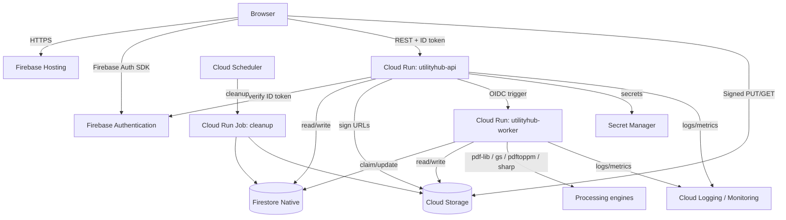

# UtilityHub — GCP Infrastructure

Version: 2.0
Date: 2026-11-18
Region assumption: `asia-southeast1` (change consistently if latency dictates)

## 1. Service topology



## 2. Components

| Component | GCP product | Purpose | Scaling |
| --- | --- | --- | --- |
| Frontend | Firebase Hosting | Static React build, SPA rewrite, CDN | Managed |
| Auth | Firebase Authentication | Google + email/password, ID tokens | Managed |
| API | Cloud Run service `utilityhub-api` | Auth, upload init, job CRUD, signed URLs | 0–10 instances, concurrency 40 |
| Worker | Cloud Run service `utilityhub-worker` | Process one job per request; poll fallback | 0–3 instances, concurrency 1 |
| Cleanup | Cloud Run Job `utilityhub-cleanup` | Expire jobs, purge metadata, delete orphan objects | Daily + scheduler |
| Database | Firestore Native mode | Jobs, uploads, users, usage | Managed |
| Objects | Cloud Storage bucket | Inputs and results | Managed |
| Secrets | Secret Manager | Signing secret, worker secret (dev), config | Managed |
| Observability | Cloud Logging + Monitoring | Structured logs, error rate, latency, budget | Managed |
| CI/CD | Cloud Build | Build/push images, deploy services, deploy hosting | Managed |

### Why a Cloud Run service worker rather than Cloud Run Jobs

- A request-scoped worker gives low-latency processing and progress updates.
- It supports a bounded drain of queued jobs per request.
- Long jobs are capped by request timeout; the same image also runs as a Cloud Run Job (`node src/worker.js --once`) for jobs that exceed the service limit.
- Cloud Run Jobs is retained for cleanup and optional large-batch processing.

## 3. Bucket design

Bucket: `utilityhub-<env>-<project-hash>` (globally unique), region-matched, uniform bucket-level access, public access prevention enforced.

| Prefix | Content | Lifecycle |
| --- | --- | --- |
| `uploads/{uid}/{uploadId}/{name}` | User inputs | App deletes at 6 h; lifecycle safety net at 1 day |
| `results/{uid}/{jobId}/{fileName}` | Processed outputs | App deletes at 24 h; lifecycle safety net at 1 day |
| `tmp/` | Never used for durable data | Delete 1 day |

Rules:

- No public objects; all access is signed or via IAM.
- CORS allows only the Firebase Hosting origin(s), methods `PUT, GET, HEAD`, headers `Content-Type`, max age 3600.
- Object names are generated; user names are sanitised and never used as paths without a generated parent.
- `Content-Disposition: attachment` is set on results.
- Versioning disabled (privacy and cost); soft delete disabled or 7 days maximum.

Lifecycle JSON is in `infra/gcs-lifecycle.json`.

## 4. Firestore design

Collections:

```text
users/{uid}
  email, displayName, photoURL, createdAt, lastSeenAt

uploads/{uploadId}
  uid, key, name, mimeType, sizeBytes, status(pending|consumed),
  jobId, createdAt, expiresAt

jobs/{jobId}
  uid, operation, status(queued|processing|done|failed|expired),
  inputs[{key,name,mimeType,sizeBytes,pageCount}],
  options{...}, inputSizeBytes,
  result{fileName,mimeType,sizeBytes,pageCount,summary,key},
  error{code,message},
  attempts, maxAttempts, leaseOwner, leaseExpiresAt,
  createdAt, updatedAt, queuedAt, startedAt, completedAt, expiresAt,
  deletedAt

usage/{uid}
  day(YYYY-MM-DD), jobsToday, bytesToday, activeJobs
```

Indexes (`infra/firestore.indexes.json`):

- `jobs`: `status ASC, createdAt ASC` (worker claim)
- `jobs`: `status ASC, expiresAt ASC` (result expiry)
- `jobs`: `status ASC, leaseExpiresAt ASC` (interrupted-worker recovery)
- `jobs`: `uid ASC, createdAt DESC` (history)
- `jobs`: `uid ASC, status ASC` (active-job count)
- `jobs`: `uid ASC, status ASC, createdAt DESC` (filtered history)
- `uploads`: `status ASC, expiresAt ASC` (expired uploads)
- `uploads`: `uid ASC, status ASC`

Security rules (`infra/firestore.rules`): **all client reads and writes are denied**. The browser never talks to Firestore; the API uses the Admin SDK, which bypasses rules. This removes an entire class of IDOR and rule-drift risk.

## 5. IAM and service accounts

| Account | Roles | Used by |
| --- | --- | --- |
| `utilityhub-api@` | `roles/datastore.user`, `roles/storage.objectAdmin` (bucket-scoped via IAM condition or custom role), `roles/secretmanager.secretAccessor`, `roles/firebaseauth.viewer` (optional) | API |
| `utilityhub-worker@` | `roles/datastore.user`, `roles/storage.objectAdmin`, `roles/logging.logWriter` | Worker |
| `utilityhub-cleanup@` | `roles/datastore.user`, `roles/storage.objectAdmin` | Cleanup job |
| `utilityhub-build@` | `roles/run.admin`, `roles/iam.serviceAccountUser`, `roles/artifactregistry.writer`, `roles/storage.admin`, `roles/firebasehosting.admin`, `roles/firebase.viewer`, `roles/cloudbuild.builds.builder` | Cloud Build |
| `utilityhub-scheduler@` | `roles/run.invoker` (on the cleanup job), `roles/logging.logWriter` | Cloud Scheduler |
| Firebase Hosting | Managed | Hosting |

Least privilege notes:

- The API does **not** need object delete on results? It does for user deletion, so object admin is scoped to the one bucket.
- No service account has project-owner or editor.
- Workers do not read Secret Manager in production (they receive only env config).
- Signed URL generation requires `iam.serviceAccounts.signBlob` on the runtime service account. Grant `roles/iam.serviceAccountTokenCreator` **on itself** to the API SA, or use the Cloud Run service account with the signBlob permission.

## 6. Configuration and secrets

Cloud Run env vars:

| Variable | API | Worker | Notes |
| --- | --- | --- | --- |
| `NODE_ENV` | production | production | |
| `GCP_PROJECT_ID` | ✓ | ✓ | |
| `GCS_BUCKET` | ✓ | ✓ | |
| `STORAGE_DRIVER` | gcs | gcs | must be `gcs` in production |
| `DB_DRIVER` | firestore | firestore | must be `firestore` in production |
| `AUTH_MODE` | firebase | firebase | must be `firebase` in production |
| `CORS_ORIGINS` | hosting origin | — | |
| `WORKER_URL` | ✓ | — | worker Cloud Run URL |
| `PUBLIC_API_URL` | ✓ | — | public origin used in API metadata; signed URL simulation only applies to the local driver |
| `MAX_*`, retention, quotas | ✓ | ✓ | shared defaults |
| `SIGNED_URL_SECRET` | dev only | dev only | Secret Manager in local/staging |

Secrets:

- `SIGNED_URL_SECRET` — only for the local storage driver and tests.
- `WORKER_SHARED_SECRET` — optional defense-in-depth alongside OIDC.
- Firebase Admin uses Application Default Credentials; no JSON key is stored.

## 7. Networking and security

- Cloud Run API is public (browser access) but every data route requires Firebase auth.
- Worker ingress is `internal-and-cloud-load-balancing`; only the API (OIDC) and Cloud Scheduler can call it.
- CORS allowlist is exactly the Firebase Hosting domain(s) and `http://localhost:5173` in development.
- Cloud Armor is optional; API-level rate limiting is mandatory and per-user quota is authoritative.
- Bucket public access prevention is enforced; no allUsers/allAuthenticatedUsers bindings.
- Firebase Auth authorized domains include the Hosting domain and localhost.
- TLS is managed by Cloud Run/Firebase Hosting.

## 8. Observability

- Structured JSON logs (pino) to stdout → Cloud Logging.
- Log fields: requestId, route, status, duration, uid hash, jobId, operation, attempt, errorCode.
- Never logged: ID tokens, authorization headers, object contents, extracted document text, signed URLs, full object keys.
- Monitoring alerts: API 5xx rate > 2%, worker failure rate > 10%, job queue age > 10 min, Cloud Run CPU/memory saturation.
- Budget alert at 50%, 90%, 100% of a monthly budget (e.g., $10 for a demo project).

## 9. Cost model (order of magnitude)

| Item | Free tier / assumption | Expected small usage |
| --- | --- | --- |
| Firebase Hosting | 10 GB storage, 360 MB/day transfer | $0 |
| Firebase Auth | 50k MAU (Identity Platform limits apply) | $0 |
| Cloud Run API | 2M requests/month free | $0–low |
| Cloud Run worker | CPU-seconds billed; scale to zero | Low; minutes of processing |
| Firestore | 50k reads / 20k writes per day free | $0–low |
| GCS | 5 GB free (regional varies) | $0–low; lifecycle keeps it small |
| Secret Manager | 6 active versions free | $0 |
| Cloud Build | 120 build-minutes/day free | $0 |
| Egress | Signed downloads from GCS | Dominant variable cost |

Guardrails: lifecycle deletion, 25 MB per file, 3 concurrent jobs, 24 h results, budget alerts. A public deployment should also enable Cloud Armor or an API gateway if abuse is likely.

## 10. Environments

| Environment | Frontend | API | Data |
| --- | --- | --- | --- |
| Local dev | Vite dev server | local Node, `memory`/`local` | local object dir, in-memory jobs |
| Staging | Firebase Hosting preview channel | Cloud Run staging | separate GCP project/bucket |
| Production | Firebase Hosting | Cloud Run prod | separate project/bucket |

Production startup **fails** if `STORAGE_DRIVER`, `DB_DRIVER`, or `AUTH_MODE` are not the cloud values.

## 11. Infrastructure as code

- `infra/setup-gcp.sh` — idempotent `gcloud` provisioning for APIs, Artifact Registry, bucket, lifecycle, CORS, service accounts, IAM, Firestore, secret, and Scheduler.
- `infra/firestore.rules`, `infra/firestore.indexes.json` — deployed with `firebase deploy --only firestore`.
- `cloudbuild.yaml` — build/push API and worker images, deploy both services, the cleanup job, and Hosting.
- `backend/Dockerfile` — API image.
- `backend/Dockerfile.worker` — worker image with Ghostscript, Poppler, Sharp; also used for the cleanup job.
- `firebase.json` — Hosting SPA config, `/api/**` rewrite to Cloud Run, CSP/security headers, Firestore rules/index paths.
- `docs/GCP_DEPLOYMENT.md` and `docs/DEPLOYMENT_RUNBOOK.md` — operator instructions.

No infrastructure is deployed by this refactor; provisioning and deployment require an authenticated GCP project and are deliberately left to the operator.
