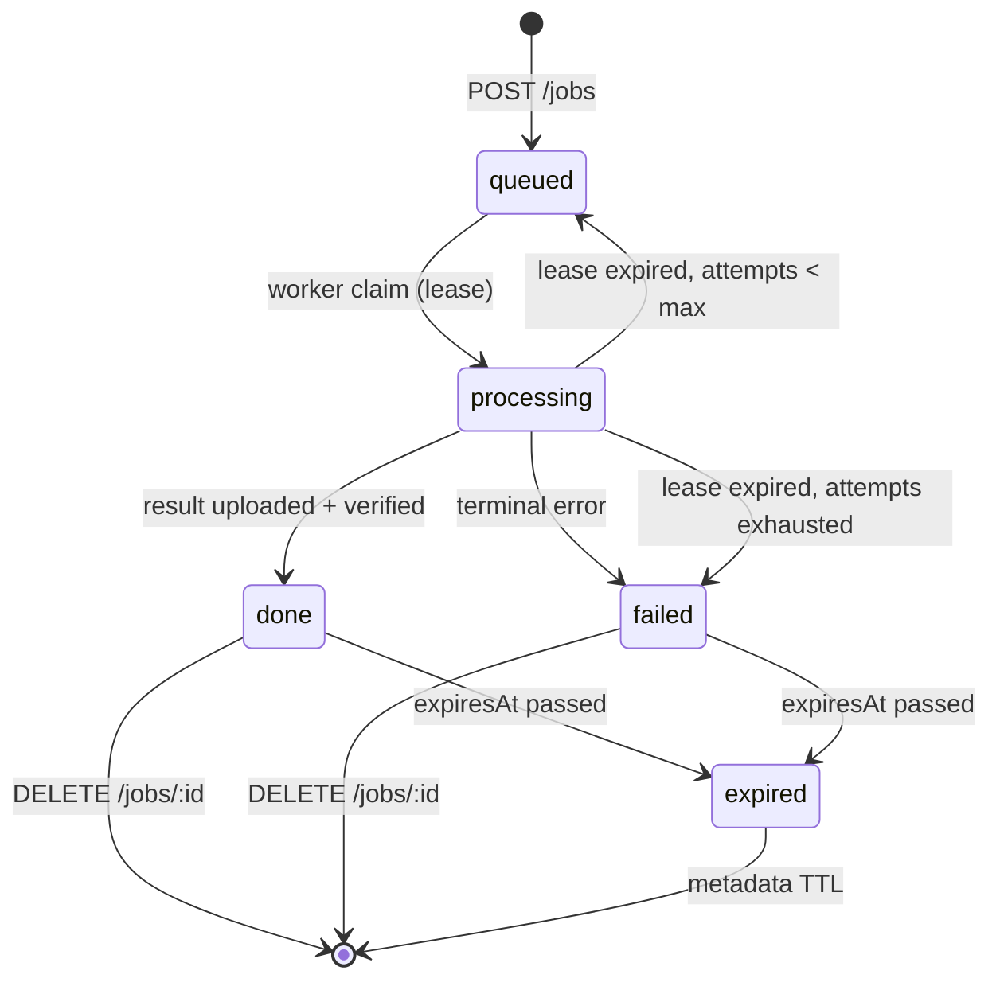
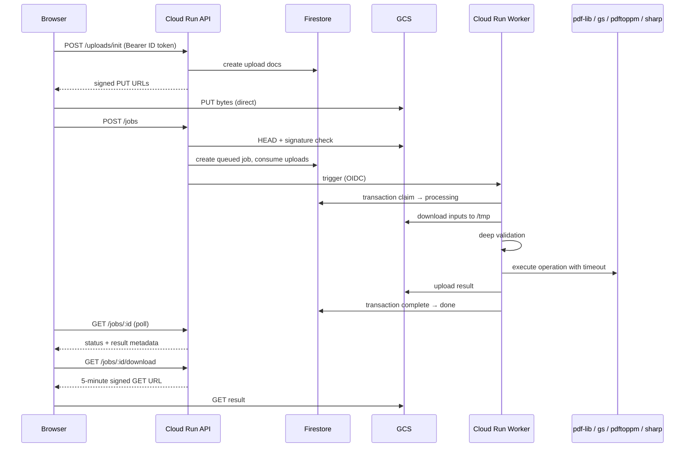

# UtilityHub — Job Lifecycle

Version: 2.0 (GCP)
Date: 2026-11-18

## 1. States

| State | Meaning | Terminal | Files present |
| --- | --- | --- | --- |
| `queued` | Job document exists, worker not yet claimed | No | Inputs in GCS |
| `processing` | Worker lease held; inputs downloaded | No | Inputs + transient temp files |
| `done` | Result uploaded and verified | Yes | Inputs + result in GCS |
| `failed` | Processing ended with a safe error | Yes | Inputs only |
| `expired` | Retention elapsed or history deleted | Yes | Removed by lifecycle/delete |

There is no `pending` state: an upload record is `pending` before the job exists. The brief's `pending → processing → done → failed → expired` maps to `queued → processing → done/failed → expired`, with `queued` being the durable pending state.

## 2. State machine

## 3. Transition guards

All updates are conditional on the expected current state.

| Transition | Guard |
| --- | --- |
| create → queued | Valid auth, owned unconsumed uploads, valid operation/options, quota available |
| queued → processing | Status is queued; lease owner is set atomically |
| processing → done | Status is processing **and** `leaseOwner` matches the worker |
| processing → failed | Status is processing **and** `leaseOwner` matches |
| processing → queued (recovery) | `leaseExpiresAt < now` and `attempts < maxAttempts` |
| processing → failed (recovery) | `leaseExpiresAt < now` and `attempts >= maxAttempts` |
| done/failed → expired | `expiresAt <= now` (computed on read; swept periodically) |
| any terminal → deleted | Owner request; active jobs rejected with `409` |

Firestore transactions implement the claim and completion updates. The in-memory adapter used by tests implements the same semantics.

## 4. Claiming and leases

- Cloud Run receives the job trigger and calls the worker. In local development
  (`WORKER_URL` unset, non-production) the API runs an in-process `JobRunner`
  because the memory store is not shared between processes. This path is
  disabled in production and in the test harness, which drives the runner
  explicitly.
- Claim procedure (transaction):
  1. Query `jobs` where `status == "queued"` order by `createdAt` limit 5.
  2. Pick the first.
  3. Re-read it; if still queued, set `status = processing`, `attempts += 1`, `leaseOwner = workerId`, `leaseExpiresAt = now + 90s`, `startedAt ??= now`.
  4. Commit.
- Concurrent workers cannot both claim the same document because the transaction re-checks `status`.
- The worker renews the lease every 30 seconds. A failed renewal aborts processing.
- Lease recovery runs at worker startup and every 60 seconds.

## 5. Processing sequence

## 6. Errors and retries

| Error class | Examples | Behaviour |
| --- | --- | --- |
| Validation / input | corrupt PDF, encrypted PDF, bad options, unsupported type | Terminal `failed` immediately; no retry |
| Engine deterministic | Ghostscript non-zero, invalid output | Terminal `failed` |
| Timeout | operation timeout, Cloud Run deadline | `failed` with `PROCESSING_TIMEOUT` |
| Transient infrastructure | GCS hiccup, Firestore unavailable, worker lost | Requeue when `attempts < 2`, else `failed` |
| Quota | per-day limit | Rejected at API, no job created |
| Storage missing | object deleted by lifecycle before job | `failed` with actionable message, input key logged only as an id |

Public error messages are fixed and safe. Internal detail goes to Cloud Logging with the job id.

## 7. Retention

| Data | Default | Mechanism |
| --- | --- | --- |
| Unconsumed uploads | 6 hours | GCS lifecycle rule `uploads/` prefix |
| Results | 24 hours | GCS lifecycle rule `results/` prefix + job `expiresAt` |
| Job metadata | 72 hours after creation | Scheduled Cloud Run job/cleanup task |
| Upload metadata | 6 hours | Cleanup task |
| Deleted jobs | Immediate | API deletes objects and document |

The UI always displays the retention window and computes "expires in" from `expiresAt`.

## 8. Expiry semantics

- `expiresAt` is set at job creation (creation + result retention) and refreshed on completion.
- `GET /jobs/:id` returns `expired` when a terminal job's `expiresAt` is in the past, even before the cleanup sweep writes the state.
- Downloads return `410 JOB_EXPIRED` after expiry.
- GCS lifecycle deletion is authoritative for bytes; Firestore cleanup is authoritative for metadata.

## 9. Concurrency and quotas

- Max active jobs per user: 3 (configurable). New jobs beyond that return `429 QUOTA_EXCEEDED`.
- Max jobs per user per day: 50.
- Max uploaded bytes per user per day: 500 MB.
- Cloud Run worker max instances: 3; each handles one job at a time.
- A job's operation timeout is enforced in-process and mirrored by a Cloud Run request deadline.

## 10. Deletion

- `DELETE /jobs/:id` verifies ownership, rejects active jobs, deletes `results/{uid}/{jobId}/` and `uploads/{uid}/{uploadId}/` objects, then deletes the Firestore document.
- `DELETE /me/jobs` applies the same rule to all terminal jobs.
- Deletion is idempotent: a missing object is not an error.
- No deleted content is recoverable.
