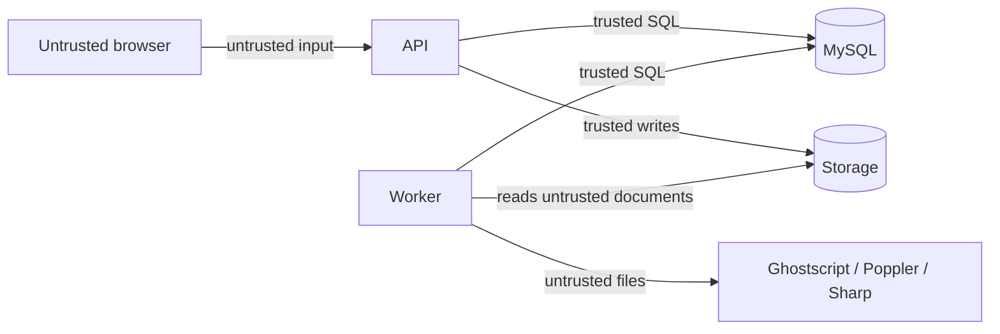

> **Superseded (2026-11-18).** This document describes the pre-GCP
> architecture (MySQL, Prisma, local disk, and/or WordPress identity). It is kept
> for traceability. See [docs/README.md](./README.md) for the current set.

# UtilityHub — Security Design

Version: 1.0
Date: 2026-11-17
Scope: guest-first local MVP, six PDF/image tools, separate API and worker

## 1. Assets and trust boundaries

| Asset | Sensitivity | Protection |
| --- | --- | --- |
| Uploaded documents | High | Generated storage names, private directory, capability authorization, retention |
| Generated outputs | High | Same controls as inputs, authorized streaming |
| Job and upload tokens | High | 256-bit random, hash-only storage, header or body delivery, never logged |
| Job metadata | Moderate | No content, short retention, sanitized errors |
| Database credentials | High | Local `.env`, not committed, least-privilege database user |
| Processing engines | Integrity-critical | Fixed binaries, argument arrays, `-dSAFER`, timeouts |
| Frontend session | Moderate | `sessionStorage`, no third-party scripts, CSP |

Trust boundaries:

The API and worker are trusted code, but every document they handle is untrusted. The browser is never trusted. WordPress, when present, is an external identity boundary, not a data boundary.

## 2. Threat model

| Threat | Vector | Impact | Controls |
| --- | --- | --- | --- |
| Malicious document | Crafted PDF/image | Engine crash, resource exhaustion, code execution in engine | Signature checks, decoders, timeouts, `-dSAFER`, non-root, container limits, no shell |
| Path traversal | Filename or storage key | Read/write outside storage | Generated UUID keys, basename-only display names, canonical containment, no user paths |
| Command injection | Filename, options, MIME | Arbitrary command execution | Argument arrays, `shell: false`, validated enums/integers, fixed binaries |
| Capability guessing | Job or upload id | Unauthorized access | 256-bit tokens, SHA-256 hash lookup, 404 on mismatch |
| Enumeration | Distinguishing missing vs unauthorized | Information leak | Identical 404 response and timing-tolerant lookup |
| Unauthorized download | Forged header or shared id | Data disclosure | Bearer token required, expiry check, no query tokens |
| Upload abuse | Huge files, many parts, slow streams | Disk or memory exhaustion | Per-file/request/count limits, streaming, request timeout, rate limit |
| Processing abuse | Huge page counts, DPI, images | CPU/memory exhaustion | Page, pixel, size, concurrency, timeout, storage reserve |
| SQL injection | User fields in raw SQL | Database compromise | Prisma parameterization, `?` placeholders, fixed identifiers |
| Zip slip | Archive entries | Filesystem overwrite | Server-generated entry names only |
| Header injection | Download filename | Response splitting | CR/LF stripping, ASCII-safe header filename |
| XSS | File name or API error rendered | Token theft | React escaping, no HTML injection, CSP, sanitized names |
| Token leakage | URLs, logs, referrer | Unauthorized access | No token in URL, redaction, `no-referrer`, `no-store` |
| Data retention | Files left indefinitely | Privacy breach | Expiry sweeps, orphan reconciliation, metadata purge |
| Privilege escalation | Container escape | Host compromise | Non-root user, no privileges, no host filesystem mounts beyond named volumes |

## 3. Authentication and authorization

### 3.1 Capability tokens

- 32 random bytes from `crypto.randomBytes`, base64url encoded.
- Upload tokens authorize attaching an upload to a job.
- Job tokens authorize status, download, and delete.
- SHA-256 hashes are stored; raw tokens are returned once and never persisted.
- Comparison is performed by looking up the stored hash for the claimed id; mismatches do not distinguish unknown ids from wrong tokens.
- Tokens are accepted only in a JSON body or the `Authorization: Bearer` header.
- Tokens are rejected in query strings; the API ignores or rejects them and never logs query strings.
- Tokens expire with their resource: uploads at input retention, jobs at metadata purge.
- There is no token recovery for guests; the UI states this.

### 3.2 Ownership rules

- Guests have no `ownerRef`; all access is by capability.
- Future authenticated jobs carry `ownerRef` and require both a valid identity claim and a job token.
- A job may only reference inputs with the same owner type and reference.
- Authentication never weakens capability checks; it adds a constraint.
- WordPress credentials and tables are never accessed by the Node.js backend.

### 3.3 CSRF and CORS

- No cookies are used for authentication, so cross-site request forgery does not apply to API state changes.
- CORS allows exact origins listed in `CORS_ORIGINS` and does not allow credentials.
- Preflight responses are cached for 10 minutes.
- State-changing endpoints require JSON content type or multipart form data; simple cross-origin form posts cannot set `application/json`.
- The frontend sends bearer headers explicitly and does not rely on ambient credentials.

## 4. Upload security

| Control | Implementation |
| --- | --- |
| Size limit | 25 MB per file enforced during streaming |
| Count limit | 20 per request |
| Request limit | 100 MB cumulative |
| Empty file | Rejected |
| Extension | Must agree with detected signature for known types |
| MIME type | Client value checked against allowlist and signature; stored value is detected |
| Magic bytes | PDF, JPEG, PNG, WebP, TIFF signatures |
| PDF structure | `pdfinfo` with timeout and output cap |
| Encryption | Any encrypted PDF rejected; no password attempts |
| Page limit | 500 at upload |
| Image decode | Sharp metadata, format allowlist, 40 MP cap, no animation/multi-page |
| Duplicate names | Irrelevant; all storage names are generated |
| Partial upload | All parts and rows from the failed request are removed |
| Slow upload | Node request timeout and rate limits |
| Filename | Sanitized for display only; no path use |

Multer writes to disk rather than buffering the whole body. The API reads only the first 4,100 bytes for signatures, then delegates PDF/image inspection. No upload is written inside a publicly served directory.

## 5. Storage and path safety

- `STORAGE_ROOT` is an absolute path outside the frontend and any static directory.
- Keys follow `uploads/YYYY/MM/<uuid>.<ext>` and `outputs/<jobId>/<uuid>.<ext>`.
- `<uuid>` comes from `crypto.randomUUID`; `<ext>` comes from the detected type.
- Every path is built by joining the canonical root with a key, then checking that the resolved path remains under the root and contains no `..` segment.
- User filenames never participate in path construction.
- Directory permissions are `0700`; file permissions are `0600`; the process sets `umask(0o077)`.
- Work directories are per job and per attempt and are deleted in `finally`.
- Symlinks are not followed for storage paths; newly created files use exclusive flags.
- ZIP entries use fixed server-generated names.
- Storage keys are never returned by the API.

## 6. Processing-engine security

| Control | Implementation |
| --- | --- |
| No shell | `spawn` with `shell: false` and argument arrays |
| Fixed binaries | Resolved from `PATH` at startup; configurable but not user-controlled |
| Restricted environment | Minimal `PATH`, `LANG`, `HOME`, `TMPDIR` |
| Working directory | Job-specific temp directory |
| Timeout | Per-call and per-operation; `SIGTERM` then `SIGKILL` |
| Output caps | 64 KiB each for stdout and stderr |
| Ghostscript | `-dSAFER`; no PostScript input accepted |
| Poppler | Read-only PDF input, page/DPI limits |
| Sharp | Sequential decode, pixel cap, normalized re-encode |
| Privileges | Worker runs as non-root with no added capabilities |
| Network | Engines receive no network configuration or credentials |
| Container limits | 2 CPU and 2 GiB memory for the worker service |

Argument values that vary are enumerations, integers, validated page numbers, or canonical paths under storage. No user string is interpolated into a command.

Residual engine risk: native decoders can contain memory-safety bugs. Isolation, non-root execution, container limits, timeouts, and the absence of network access reduce impact but do not make malformed input safe by assertion. Tests must include malformed and truncated inputs.

## 7. Download security

- Authorization happens before the file is opened.
- Job must be `COMPLETED`, unexpired, not deleted, and token hash must match.
- The artifact MIME type is from the stored metadata and limited to PDF, PNG, JPEG, or ZIP.
- `Content-Disposition` uses a sanitized ASCII filename with quotes escaped; CR, LF, and control characters are removed.
- `Content-Type` is fixed by stored metadata, never by the client.
- `X-Content-Type-Options: nosniff` prevents content sniffing.
- `Cache-Control: private, no-store` prevents shared caching.
- `Content-Security-Policy: sandbox` may be added for downloads; it is not required for attachment delivery.
- The API streams rather than buffering, so large outputs do not expand memory.
- Unauthorized and missing cases return the same 404 body. A valid token for an expired or deleted job receives 410.

## 8. Denial-of-service controls

| Layer | Limit |
| --- | --- |
| Global API rate | 300 requests/minute/IP |
| Upload rate | 30 requests/10 minutes/IP |
| Job creation rate | 60 requests/10 minutes/IP |
| Download rate | 120 requests/10 minutes/IP |
| JSON body | 64 KiB |
| Multipart request | 100 MB, 20 files, 25 MB each |
| PDF pages | 500 at upload; 2,000 merged; 100 rendered |
| Image pixels | 40 MP input; 50 MP rendered page |
| Job input | 150 MB |
| Worker concurrency | 2 |
| Operation timeout | 90–300 seconds by operation |
| Storage reserve | 2 GB free required to start a job |

Rate limiting is in-memory, per API process. It resets on restart and does not coordinate across processes. This is a documented limitation of the single-process MVP. `X-Forwarded-For` is not trusted unless `TRUST_PROXY` is explicitly enabled. Server timeouts bound header and request duration.

## 9. Data protection and privacy

- Document bytes are stored only on local disk and are not sent to external services.
- Databases store metadata, not content.
- File names are used for display; logs use file ids instead.
- Job errors are sanitized and limited to 500 characters.
- Engine stderr is capped and logged without document content; it is never returned.
- Tokens, authorization headers, cookies, and query strings are redacted from logs.
- No text extraction or OCR exists in the MVP, so no document text can leak through logs.
- Inputs are deleted at 60 minutes, outputs at 60 minutes after completion, and metadata 24 hours after expiry.
- Deleting a terminal job makes it undownloadable immediately and removes files by the next cleanup cycle.
- Orphaned files older than 24 hours are removed.
- Backups of the database are not part of the MVP; the local volume is not a long-term archive.

## 10. Logging and error hygiene

Allowed log fields:

- request id, job id, file id, operation id;
- status transitions, attempts, durations, byte counts;
- error code and internal detail code;
- worker id, claim counts, cleanup counts;
- rate-limit decisions without tokens.

Forbidden log fields:

- raw tokens, authorization headers, cookies;
- original filenames, document content, extracted text;
- storage keys or absolute paths;
- SQL text containing values;
- engine command lines containing user data.

Responses expose only a stable code, a safe message, optional field-level details, and the request id. Stack traces and engine stderr remain server-side.

## 11. Headers and browser hardening

API:

- `X-Content-Type-Options: nosniff`
- `Referrer-Policy: no-referrer`
- `Cache-Control: no-store`
- `X-Frame-Options: DENY`
- `Cross-Origin-Resource-Policy: same-site`
- `Permissions-Policy` disabling camera, microphone, and geolocation
- Helmet defaults; HSTS is emitted only when `NODE_ENV=production`
- CORS as configured

Frontend:

- Content Security Policy in `frontend/index.html` restricting scripts to self, allowing only inline styles used by React, and limiting connections to the app origin and its development WebSocket.
- Additional security headers from the Vite dev and preview servers (`nosniff`, `no-referrer`, `DENY`, permissions policy).
- No third-party analytics, fonts, or scripts.
- React renders file names as text; `dangerouslySetInnerHTML` is not used.
- Tokens stay in `sessionStorage` for the current tab and are cleared when the user starts over.
- No tokens in URLs, history, or referrer headers.

The API serves JSON and files only, so its CSP uses `default-src 'none'`. The frontend Docker image runs the Vite development server for local use; the checked-in production build uses the same CSP meta tag.

## 12. Container and deployment hardening

- API, worker, and frontend run as non-root users.
- Worker and API use the same image but separate commands and separate containers.
- `no-new-privileges:true` for every service; all Linux capabilities are dropped for the API, worker, and web containers.
- Worker concurrency is bounded at 2 and operation timeouts are enforced by application code. The local Compose profile does not set hard container memory or CPU limits.
- Only localhost ports are published; MySQL is published on `3307` only for local development.
- No Docker socket mount, no privileged mode, no host network.
- Storage volume is writable only by the application containers.
- Database credentials are environment variables from an untracked `.env`.
- The MySQL user for the application has privileges only on `utilityhub.*`.
- Images are built from pinned base tags. `npm audit` reports zero known vulnerabilities after the `deepmerge-ts` and `minimatch` overrides recorded in `docs/SECURITY_REVIEW.md`.

## 13. Residual risks

| Risk | Severity | Mitigation and status |
| --- | --- | --- |
| Native decoder vulnerability in Ghostscript, Poppler, or Sharp | High if exploited | Non-root, container, timeout, no network, limits; accepted for local MVP |
| Malicious PDF consumes CPU within timeout | Medium | Timeouts, concurrency 2, storage reserve; accepted |
| In-memory rate limit bypass after restart | Low | Restart is operator-controlled; documented |
| Guest token theft through client XSS | Medium | CSP, no third-party scripts, React escaping, sessionStorage |
| No malware scanning | Medium | Files are never executed; rendering is isolated; downloads are attachments |
| PDF metadata may contain author or title PII | Low | Metadata is preserved, not logged, and files are short-lived |
| Single-node filesystem | Medium | Local MVP; storage adapter ready for object storage |
| No per-process memory cap for Sharp | Medium | Sequential processing, pixel caps, bounded worker concurrency |
| No hard container memory or CPU limits | Low | Local Compose profile; application limits and timeouts remain enforced |
| Rootless Docker user namespace differences | Low | Deployment verified in Phase 3 |
| WordPress integration not verified against a live WordPress install | Informational | Guest flow independent; plugin and signed-token contract tested with controlled fixtures |

## 14. Verification checklist

Phase 10 executed these checks; results and evidence are recorded in `docs/SECURITY_REVIEW.md`.

1. Upload with `../../etc/passwd` as the filename; the file is stored under a generated name and the display name is sanitized.
2. Upload a file whose extension and signature disagree; rejected.
3. Upload a file whose declared MIME type disagrees; rejected or corrected by detection.
4. Upload an encrypted PDF; rejected without password attempts.
5. Upload a truncated PDF and a truncated JPEG; rejected or failed without a crash.
6. Upload 21 files and a 26 MB file; rejected with the correct codes.
7. Create a job with a wrong upload token; rejected.
8. Request status and download with a wrong job token; both 404.
9. Attempt download before completion; 409.
10. Expire a job and attempt download; 410, and files are absent after cleanup.
11. Submit a filename containing shell metacharacters; processing succeeds or fails safely with no shell interpretation.
12. Request pages outside range, negative pages, and reversed ranges; rejected.
13. Request 101 pages for PDF to Images; rejected.
14. Request a 200 DPI render of an oversized page; rejected by the pixel budget.
15. Kill the worker during processing; job is recovered and terminal.
16. Start two workers; no job is processed twice.
17. Inspect logs for tokens, filenames, paths, and document content; none present.
18. Inspect API errors for paths, SQL, stack traces, and commands; none present.
19. Confirm storage file modes are `0600` and directory modes are `0700`.
20. Confirm CORS rejects an unlisted origin and allows the configured one.
21. Confirm rate limits return 429 with `Retry-After`.
22. Run `npm audit` and record unresolved advisories before claiming Phase 10 complete.
